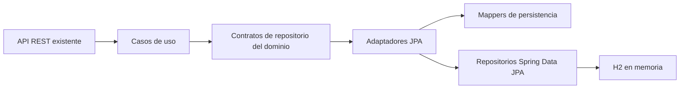

# BOHEME — Entregable 2, apartado 2.5

## Arquitectura

Los ocho casos de uso conservan los contratos `PrendaDeAutorRepository` y
`BolsaDeEstiloRepository` del dominio. En ejecución normal Spring inyecta
`JpaPrendaDeAutorRepository` y `JpaBolsaDeEstiloRepository`. Estos adaptadores
utilizan repositorios Spring Data JPA y mappers independientes de los REST.

Los repositorios `InMemory...` permanecen disponibles para instanciación explícita
en pruebas; no son beans, de modo que no hay conflictos de inyección ni un modo
HashMap activado accidentalmente en la aplicación.



## Tablas y relaciones

| Tabla | Entidad JPA | Contenido |
|---|---|---|
| `prendas_autor` | `PrendaJpaEntity` | UUID, creadorId, nombre, descripción, precio, moneda, escala, disponibilidad, stock total, versión y eliminado |
| `variantes_prenda` | `VarianteJpaEntity` | UUID original, FK prenda_id, SKU, talla como texto, stock, posición y eliminado |
| `bolsas_estilo` | `BolsaJpaEntity` | UUID, clienteId, cerrada, versión y eliminado |
| `lineas_bolsa` | `LineaBolsaJpaEntity` | UUID técnico, FK bolsa_id, varianteId, cantidad, precio unitario, moneda, escala, posición y eliminado |

`DineroJpa` es un `@Embeddable`: no crea otra tabla.

Las raíces tienen relaciones `@OneToMany` con sus elementos, con cascadas y
`orphanRemoval`. Los elementos tienen `@ManyToOne` hacia su raíz. Las claves
foráneas protegen esas dos relaciones de pertenencia. La posición se guarda
explícitamente para conservar el orden de las listas.

`creadorId` y `clienteId` son referencias externas UUID, como en los agregados
actuales. No se crearon entidades JPA de usuarios, creadores, vitrinas o pedidos.

`lineas_bolsa.variante_id` conserva una referencia externa por UUID y tiene un
índice, pero no es una asociación ORM ni una FK hacia el catálogo. Esto respeta
el modelo existente, que no exige verificar la existencia de la variante al
construir una línea, y permite leer la selección y su precio histórico aunque
la prenda/variante se haya eliminado lógicamente. No se aplica borrado en cascada
desde el catálogo hacia las bolsas.

## Reconstrucción e invariantes

`PrendaDeAutor.reconstruir(...)` acepta la disponibilidad guardada y delega en el
constructor privado que ya valida precio, stock, identidad y variantes.

`BolsaDeEstilo.reconstruir(...)` valida identidad, lista, líneas no nulas,
ausencia de variantes duplicadas y coherencia de moneda, y conserva el estado
cerrado. Las cantidades y precios se reconstruyen con sus Value Objects.

No se llama a `agregarLinea` con inventario inventado para rehidratar la bolsa.
El stock se valida al agregar; el inventario actual puede haber cambiado desde
la selección y no debe impedir leer una bolsa histórica. Una bolsa reconstruida
cerrada sigue rechazando modificaciones de contenido.

Los constructores del dominio siguen siendo privados y no se añadieron setters
ni imports de Spring/JPA/HTTP al dominio. Los constructores sin argumentos de las
clases JPA son protegidos, conforme a su responsabilidad independiente.

## Mappers y transacciones

- `PrendaJpaMapper`: convierte la raíz y sus variantes conservando IDs y estados.
- `BolsaJpaMapper`: convierte la raíz y sus líneas conservando cantidades, precio
  histórico y estado. Los UUID técnicos de líneas se conservan al actualizarlas.
- `DineroJpaMapper`: convierte monto, moneda y escala de BigDecimal.

Los adaptadores cargan filas gestionadas y sincronizan las colecciones por ID.
Actualizar un elemento existente no elimina y reinserta toda la colección.
Los elementos retirados pasan por orphan removal con soft delete.

Las lecturas y la conversión al dominio se completan dentro de transacciones;
los `EntityGraph` cargan las colecciones necesarias. Esto funciona con
`spring.jpa.open-in-view=false`. Los métodos de escritura participan en las
transacciones de los casos de uso existentes o abren una cuando se llaman solos.
Las raíces tienen `@Version`; no se implementó todavía una política completa
de concurrencia ni versionado de snapshots del dominio.

### Dinero

El dominio no impone dos decimales. Para no redondear valores válidos, H2 guarda
el monto en `DECFLOAT(100000)` y la escala original en `precio_escala`; la moneda
se guarda por separado. Al reconstruir se restaura la escala exacta, incluida
su importancia para la igualdad de `BigDecimal` y del Value Object `Dinero`.

No se usa coma flotante binaria. La columna sigue siendo numérica para futuros
filtros, ordenamientos y agregaciones. Es una decisión específica de H2, con su
límite de 100000 dígitos de precisión; deberá revisarse al elegir otro motor.

## Eliminación lógica

Las cuatro entidades usan Hibernate `@SoftDelete(columnName = "eliminado")`:

- `false`: fila activa.
- `true`: fila eliminada lógicamente.

Hibernate transforma la eliminación de entidades en `UPDATE` y filtra las filas
eliminadas de las consultas ORM normales, incluidas las colecciones. No se
declaran borrados nativos ni se exponen operaciones batch de borrado en los
repositorios Spring Data.

Capacidad disponible exclusivamente en infraestructura:

```java
jpaPrendaDeAutorRepository.eliminarLogicamente(prendaId);
jpaBolsaDeEstiloRepository.eliminarLogicamente(bolsaId);
```

Estas operaciones marcan la raíz y sus elementos en cascada. Si no existe una
fila activa, no hacen nada. Guardar nuevamente un agregado cuyo UUID pertenece
a una raíz eliminada se rechaza; no lo resucita ni sobrescribe su historial.

Vaciar una bolsa marca sus líneas como eliminadas, conservando la bolsa activa.
Si después se agrega otra vez la misma variante desde el dominio, se crea una
nueva fila técnica; la línea anterior continúa conservada como historial.

Suspender una prenda cambia `disponible_para_venta`; cerrar una bolsa cambia
`cerrada`. Ninguna de estas operaciones significa eliminación lógica.
No se añadieron endpoints de eliminación de agregados.

Las únicas consultas nativas de producción cuentan IDs incluyendo tombstones
para evitar sobrescrituras y duplicaciones del inicializador. No son consultas
de lectura normales del dominio. Las consultas SQL de auditoría deben considerar
explícitamente el indicador `eliminado`.

`ddl-auto=create-drop` sigue creando y retirando el esquema de demostración al
arrancar/parar. Esto es distinto del borrado de registros durante operaciones
de negocio y es coherente con la configuración H2 en memoria solicitada.

## Datos iniciales

`DatosIniciales` es un `CommandLineRunner` transaccional. Utiliza fábricas de
dominio y repositorios; no inserta productos en controllers ni omite invariantes.

Se habilita por defecto con `boheme.datos-iniciales.enabled=true`; puede
deshabilitarse con `false` en pruebas o mediante configuración externa.

| Datos al arrancar una base nueva | Cantidad |
|---|---|
| Prendas | 3 |
| Variantes | 5 |
| Bolsas | 2 |
| Líneas | 3 |

Hay dos creadores ficticios, varias tallas y existencias (incluido stock cero),
precios en COP y USD, una bolsa activa y otra cerrada. Cada bolsa mantiene una
sola moneda. No se usan datos personales reales.

Identificadores para explorar desde Swagger:

```text
Creador 1: 81000000-0000-4000-8000-000000000001
Creador 2: 81000000-0000-4000-8000-000000000002
Cliente con bolsa activa: c1000000-0000-4000-8000-000000000001
Cliente con bolsa cerrada: c1000000-0000-4000-8000-000000000002
Prendas: 91000000-0000-4000-8000-000000000001 ... 000000000003
Bolsas: b1000000-0000-4000-8000-000000000001 ... 000000000002
```

El inicializador usa IDs estables y comprueba su presencia incluso si están
eliminados. Repetirlo no duplica filas, no reemplaza cambios existentes y no
resucita raíces eliminadas. La prueba de integración verifica estos casos.

## Verificación

```powershell
.\gradlew.bat clean test
.\gradlew.bat bootRun
```

Resultado verificado del apartado 2.5: **99 pruebas exitosas**: 79 anteriores,
4 de reconstrucción, 12 con `@DataJpaTest` y 4 de integración de casos de uso y
datos iniciales. Las pruebas de persistencia hacen flush/clear antes de releer;
se aíslan mediante rollback, IDs de prueba y bases separadas por contexto.

También se verificó por HTTP real y SELECT desde la consola H2:

- Las cuatro tablas, sus dos FK de pertenencia y las cantidades iniciales.
- Registro de prenda por API y presencia de sus filas en H2.
- Consulta posterior, actualización de stock y suspensión persistidas.
- Creación, consulta y cierre de bolsas, diferenciando cierre de eliminación.
- Vaciado de la bolsa demo con líneas: dos filas conservadas con eliminado=true
  y respuesta REST posterior sin esas líneas.
- Las ocho operaciones en OpenAPI y Swagger UI disponible.

Consola: <http://localhost:8080/h2-console>. Conexión:
`jdbc:h2:mem:ecommercedb`, usuario `sa`, contraseña vacía.

Consultas de inspección de solo lectura:

```sql
SELECT * FROM prendas_autor;
SELECT * FROM variantes_prenda;
SELECT * FROM bolsas_estilo;
SELECT * FROM lineas_bolsa;
SELECT * FROM lineas_bolsa WHERE eliminado = TRUE;
```

Los datos desaparecen al detener el proceso. Las verificaciones HTTP modifican
los datos de demostración durante esa ejecución; reiniciar recrea el conjunto.

## Preparación para 2.6 y límites

Se conservan columnas consultables de nombre/descripción, precio numérico,
creador, talla, stock y estado, así como las relaciones raíz-elementos y el ID
de variante en líneas. Esto permite diseñar posteriormente paginación, búsqueda,
filtros y joins sin almacenar el agregado como un JSON opaco. No se implementaron
los endpoints ni las consultas avanzadas de 2.6.

Las bolsas permiten medir selección o interés actual mediante cantidades; no
demuestran ventas. Un ranking real de ventas necesita pedidos persistidos con
líneas (variante/prenda, cantidad, precio histórico), fecha y un estado que
distinga pedidos pagados/completados de cancelados. La ampliación mínima sería
persistir ese agregado y sus líneas cuando se implemente el proceso de pedido.
`PedidoDeModa` por sí solo hoy no contiene líneas con cantidades y precios.

Se conservan las reglas previas: stock total independiente del de variantes,
varias bolsas activas posibles por cliente, ausencia de autenticación hasta
2.7 y ausencia de una operación REST para agregar artículos. No se implementó
MariaDB, JWT, frontend ni procesos de pago.
